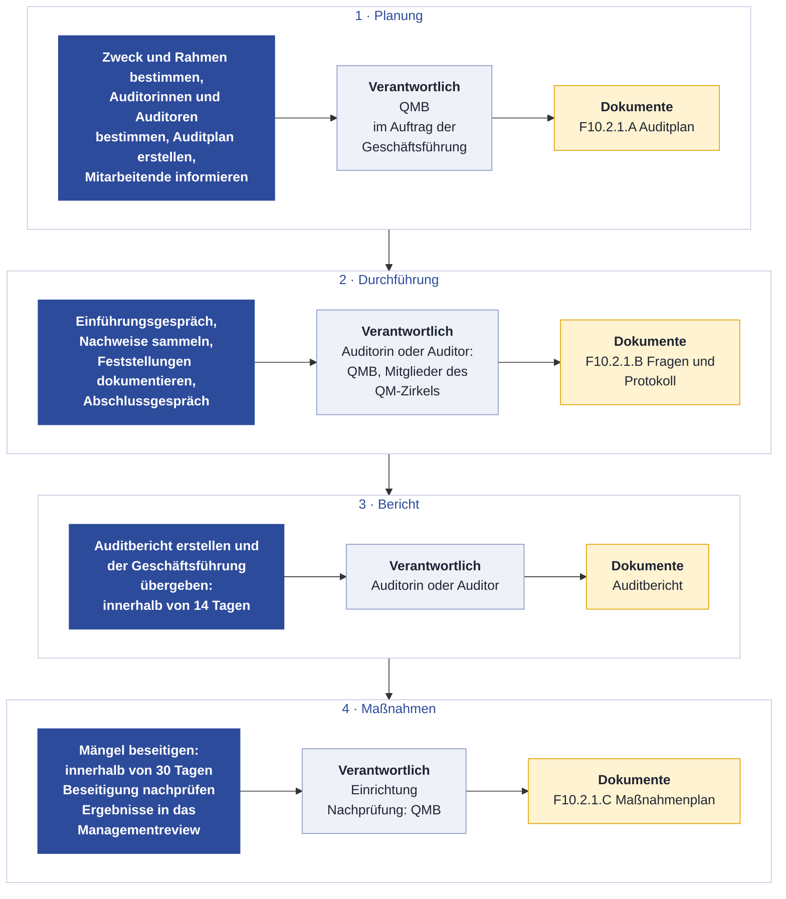

# 10.2.1 Interne Audits

Kapitel: 10 Kontinuierliche Qualitätsverbesserung · 10.2 Qualitätsprüfungen · Kennung: 10.2.1 · Revision: 0003 (Entwurf) · Stand: 20.11.2026

Zugeordnete Prozesse: Managementprozess QM

Leitorientierung: Im internen Audit prüft der Träger selbst, ob die Arbeit den eigenen Vorgaben entspricht und wo die Vorgaben besser werden müssen. Jede Einrichtung wird in drei Jahren zweimal auditiert. Der Bericht liegt nach 14 Tagen vor, Mängel sind nach 30 Tagen beseitigt.

## 1 Ablauf

Lesart: je Zeile ein Abschnitt des Ablaufs; links der Prozessschritt (blau), in der Mitte die Verantwortung (hellblau), rechts die Dokumente (gelb). Die Vorlage enthält kein Flussdiagramm; die Darstellung ist aus der Beschreibung abgeleitet.

## 2 Checkliste

### Planung

- [ ] Zweck und Rahmen des Audits bestimmt
- [ ] Auditorin oder Auditor bestimmt
- [ ] Auditplan erstellt (F10.2.1.A)
- [ ] Mitarbeitende der Einrichtung informiert

### Durchführung

- [ ] Einführungsgespräch geführt
- [ ] Nachweise gesammelt
- [ ] Feststellungen im Protokoll oder Maßnahmenplan dokumentiert
- [ ] Abschlussgespräch geführt

### Bericht

- [ ] Auditbericht erstellt
- [ ] Innerhalb von 14 Tagen der Geschäftsführung übergeben

### Maßnahmen

- [ ] Maßnahmen im Maßnahmenplan festgelegt (F10.2.1.C)
- [ ] Mängel innerhalb von 30 Tagen beseitigt
- [ ] Beseitigung von der QMB nachgeprüft
- [ ] Ergebnisse für das Managementreview bereitgestellt

## 3 Zugehörige Dokumente, Formulare und Rechtsgrundlagen

| Art | Bezeichnung | Fundstelle |
|---|---|---|
| Norm | ISO 9001:2015, Abschnitt 9.2 Internes Audit | liegt dem Träger vor |
| QM-Handbuch | 10.2.2 Externe Audits | QM-Handbuch |
| QM-Handbuch | 2.3.3 Kontext der Organisation (Standorte) | QM-Handbuch |
| Formular | F10.2.1.A Auditplan | OFFEN |
| Formular | F10.2.1.B Fragen und Protokoll zum internen Audit | OFFEN |
| Formular | F10.2.1.C Maßnahmenplan | OFFEN |

## 4 Zweck und Zuständigkeit

| | |
|---|---|
| Zweck | Überprüfung der qualitätsrelevanten Tätigkeiten in Bezug auf die Vorgaben |
| verantwortlich | Geschäftsführung |
| beteiligt | QMB, Mitglieder des QM-Zirkels |
| Norm | ISO 9001:2015 |

## 5 Beschreibung

| Nr. | Beschreibung | verantwortlich | Dokumente/Formulare |
|---|---|---|---|
| 1 | Das interne Audit dient der Stabilisierung und Weiterentwicklung der eigenen Grundsätze und Forderungen an die Qualität. Es ist ein wesentliches Element des QM-Systems und wird im Auftrag der Geschäftsführung durchgeführt. | Geschäftsführung | |
| 2 | Maßstab sind die in der QM-Dokumentation festgelegten Grundsätze, Maßnahmen und Maßstäbe. | Geschäftsführung | |
| 3 | Jede Einrichtung wird in einem Zertifizierungszeitraum von drei Jahren einmal vollständig überprüft. Dazu finden je Einrichtung in drei Jahren zwei interne Audits statt, eines mit dem Schwerpunkt Strukturdaten und eines mit dem Schwerpunkt Betreuungsprozesse. | QMB | F10.2.1.A Auditplan |
| 4 | Audits mehrerer Einrichtungen können gemeinsam stattfinden, wenn die Einrichtungen von gleicher Art sind, zum Beispiel Wohngruppen oder Tagesgruppen. | QMB | |
| 5 | Die QMB organisiert die Audits:; – Notwendigkeit und Zweck bestimmen; – Auditorinnen und Auditoren bestimmen; – Rahmen festlegen; – Auditplan erstellen; – Maßnahmen festlegen und die Mitarbeitenden informieren | QMB | F10.2.1.A Auditplan; F10.2.1.C Maßnahmenplan |
| 6 | Auditorinnen und Auditoren sind die QMB und die Mitglieder des QM-Zirkels. Sie auditieren nicht den eigenen Fachbereich. | QMB; Mitglieder des QM-Zirkels | |
| 7 | Durchführung:; – Einführungsgespräch; – Nachweise sammeln und Feststellungen im Auditprotokoll oder im Maßnahmenplan dokumentieren; – Abschlussgespräch | Auditorin oder Auditor | F10.2.1.B Fragen und Protokoll |
| 8 | Die Auditorin oder der Auditor erstellt einen Auditbericht und übergibt ihn innerhalb von 14 Tagen nach dem Audit der Geschäftsführung. | Auditorin oder Auditor | Auditbericht |
| 9 | Festgestellte Mängel werden verfolgt und innerhalb von 30 Tagen durch Maßnahmen beseitigt. Die QMB prüft die Beseitigung nach. | Einrichtung; QMB | F10.2.1.C Maßnahmenplan |
| 10 | Die Ergebnisse der internen Audits gehen in das Managementreview ein. | QMB | |

## Risikobetrachtung

Vorschlag; vom Träger nicht bestätigt.

Risiko: Audits fallen aus oder werden zur Formsache. Mängel werden festgestellt und nicht beseitigt.

Risikominimierung: Auditplan über drei Jahre; Frist von 30 Tagen mit Nachprüfung durch die QMB; Auditorinnen und Auditoren aus einem anderen Fachbereich; Ergebnisse im Managementreview.

## Reflexion und Weiterentwicklung

Vorschlag; vom Träger nicht bestätigt.

Leitfragen:

1. Was hat das Audit gezeigt, das im Alltag nicht aufgefallen wäre?
2. Welche Vorgabe hat sich im Audit als unpraktisch oder überflüssig erwiesen?
3. Wie haben die Mitarbeitenden der Einrichtung das Audit erlebt: als Hilfe oder als Kontrolle?

Ort der Reflexion: je nach Thema und Handlungsebene. Rückmeldungen gehen an die Qualitätsmanagementbeauftragte oder den Qualitätsmanagementbeauftragten (QMB).

## Offene Punkte

OFFEN: Die Formulare F10.2.1.A, F10.2.1.B und F10.2.1.C liegen im Repository nicht vor; die Vorlage vermerkt sie als „nicht hinterlegt“. Die Kennungen sind nach dem Muster vergeben (Standard, Nr. 32).

OFFEN: Auditplan: Zeitraum (ein Jahr oder drei Jahre) und Termin, bis zu dem er vorliegt. Frist, mit der die Einrichtung vor dem Audit informiert wird.

OFFEN: „nicht den eigenen Fachbereich“: Die Vorlage sagt „eigene Mitarbeiter (aus anderen Fachbereichen)“. Zu bestätigen ist, dass das für die Mitglieder des QM-Zirkels gilt, und wer den Bereich der QMB auditiert. Voraussetzungen für die Tätigkeit als Auditorin oder Auditor (zum Beispiel Schulung) sind nicht genannt.

OFFEN: Beginn der Frist von 30 Tagen (Audit oder Auditbericht) und Vorgehen, wenn ein Mangel in 30 Tagen nicht zu beseitigen ist.

OFFEN: Inhalt des Auditberichts. Aufbewahrung von Auditplan, Protokoll, Bericht und Maßnahmenplan als Nachweis.

OFFEN: Das Managementreview ist noch nicht beschrieben; der Verweis in Nr. 10 folgt der Festlegung des Trägers vom 20.11.2026.

OFFEN: Erstellende Stelle und Verteiler.

## Änderungen

| Revision | Datum | Änderung | Grund |
|---|---|---|---|
| 0002 | 04.2024 | Stand der Vorlage (zwei Seiten; erstellt 08.03.2011, geprüft und freigegeben 19.04.2024) | – |
| 0003 (Entwurf) | 20.11.2026 | Überführung in Markdown; Ablauf aus der Beschreibung abgeleitet und an erste Stelle gesetzt; Checkliste, Verweise, Risikobetrachtung, Leitfragen und Leitorientierung ergänzt | Standard QM-Dokumente |
| 0003 (Entwurf) | 20.11.2026 | „regelmäßig“ gestrichen (Turnus steht in Nr. 3); Auditorinnen und Auditoren: QMB und Mitglieder des QM-Zirkels; Auditplan durch die QMB; Auditbericht innerhalb von 14 Tagen; Mängel innerhalb von 30 Tagen, Nachprüfung durch die QMB; Ergebnisse in das Managementreview | Festlegungen des Trägers vom 20.11.2026 |
| 0003 (Entwurf) | 20.11.2026 | Bereinigt: Wir-Form, „MitarbeiterInnen“, „AuditorIn“, „SWS“, „etc.“; „wenn die Gegebenheiten der Gruppen zueinander passen“ zu „von gleicher Art“; Formulare mit Kennung | Schreibregeln des Trägers; Standard, Nr. 32 |

Vorlage: `alt/10.2.1_interne_Audits.docx`. Befunde: `befunde-gliederung.md`, Nr. 92 bis 94.
