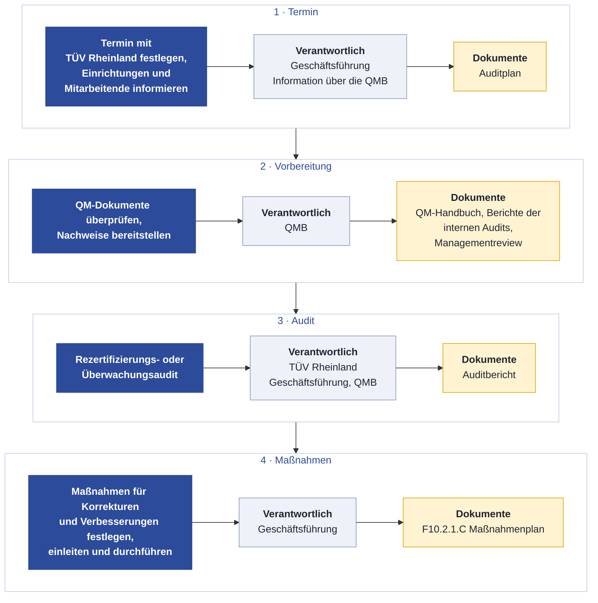

# 10.2.2 Externe Audits

Kapitel: 10 Kontinuierliche Qualitätsverbesserung · 10.2 Qualitätsprüfungen · Kennung: 10.2.2 · Revision: 0004 (Entwurf) · Stand: 20.11.2026

Zugeordnete Prozesse: Managementprozess QM

Leitorientierung: Einmal im Jahr prüft TÜV Rheinland von außen, ob das QM-System funktioniert: als Rezertifizierungs- oder als Überwachungsaudit. Zu diesem Termin sind alle QM-Dokumente überprüft. Aus dem Auditbericht folgen Maßnahmen.

## 1 Ablauf

Lesart: je Zeile ein Abschnitt des Ablaufs; links der Prozessschritt (blau), in der Mitte die Verantwortung (hellblau), rechts die Dokumente (gelb). Die Vorlage enthält kein Flussdiagramm; die Darstellung ist aus der Beschreibung abgeleitet.

## 2 Checkliste

### Termin

- [ ] Termin mit TÜV Rheinland festgelegt
- [ ] Auditplan liegt vor
- [ ] Einrichtungen und Mitarbeitende über die QMB informiert

### Vorbereitung

- [ ] Alle QM-Dokumente überprüft
- [ ] Berichte der internen Audits und Managementreview liegen vor

### Nach dem Audit

- [ ] Auditbericht liegt vor
- [ ] Maßnahmen im Maßnahmenplan festgelegt (F10.2.1.C)
- [ ] Maßnahmen durchgeführt

## 3 Zugehörige Dokumente, Formulare und Rechtsgrundlagen

| Art | Bezeichnung | Fundstelle |
|---|---|---|
| Norm | ISO 9001:2015 | liegt dem Träger vor |
| QM-Handbuch | 10.2.1 Interne Audits | QM-Handbuch |
| QM-Handbuch | 2.3.3 Kontext der Organisation (Anwendungsbereich, Standorte) | QM-Handbuch |
| QM-Handbuch | 8.9.3 Lenkung von Formularen und Dokumenten (Überprüfung zum externen Audit) | QM-Handbuch |
| Dokument des Zertifizierers | Auditplan, Auditbericht, Zertifikat | OFFEN |
| Formular | F10.2.1.C Maßnahmenplan | OFFEN |

## 4 Zweck und Zuständigkeit

| | |
|---|---|
| Zweck | Ermittlung, ob die festgelegten Forderungen erfüllt werden |
| verantwortlich | Geschäftsführung |
| beteiligt | QMB, Auditorinnen und Auditoren |
| Norm | ISO 9001:2015 |

## 5 Beschreibung

| Nr. | Beschreibung | verantwortlich | Dokumente/Formulare |
|---|---|---|---|
| 1 | Externe Audits führen externe Organisationen durch, die ein Interesse an der Einrichtung haben. Beim Träger auditiert und zertifiziert TÜV Rheinland. | Geschäftsführung | |
| 2 | Ziel ist die Begutachtung der Qualitätsfähigkeit, die Zertifizierung und der Erhalt des Zertifikats als Bestätigung eines funktionierenden QM-Systems. | Geschäftsführung | Zertifikat |
| 3 | Das externe Audit findet jährlich statt: im Zertifizierungszeitraum von drei Jahren als Rezertifizierungsaudit oder als Überwachungsaudit. | Geschäftsführung | Auditplan |
| 4 | Die Geschäftsführung legt mit TÜV Rheinland den Termin fest und informiert über die QMB die Einrichtungen und die Mitarbeitenden. | Geschäftsführung | Auditplan |
| 5 | Zum externen Audit ist jedes QM-Dokument überprüft (8.9.3). | QMB | |
| 6 | Nach Vorlage des Auditberichts werden Maßnahmen festgelegt, um Korrekturen und Verbesserungen einzuleiten und durchzuführen. | Geschäftsführung | Auditbericht; F10.2.1.C Maßnahmenplan |

## Risikobetrachtung

Vorschlag; vom Träger nicht bestätigt.

Risiko: Das Audit wird nur kurz vor dem Termin vorbereitet; Feststellungen aus dem Auditbericht bleiben ohne Maßnahme. Im äußersten Fall geht das Zertifikat verloren.

Risikominimierung: Überprüfung aller QM-Dokumente zum Termin; interne Audits nach 10.2.1; Maßnahmenplan nach jedem Auditbericht.

## Reflexion und Weiterentwicklung

Vorschlag; vom Träger nicht bestätigt.

Leitfragen für die Geschäfts- und Fachleitung:

1. Welche Feststellung des Auditberichts war überraschend, und warum hat das interne Audit sie nicht gezeigt?
2. Was wurde nur für das Audit getan und nützt der Arbeit nicht?
3. Welche Empfehlung aus dem letzten Audit ist noch offen?

Ort der Reflexion: je nach Thema und Handlungsebene. Rückmeldungen gehen an die Qualitätsmanagementbeauftragte oder den Qualitätsmanagementbeauftragten (QMB).

## Offene Punkte

OFFEN: Frist, mit der Einrichtungen und Mitarbeitende vor dem Audit informiert werden, und Weg der Information (zum Beispiel QM-Rundbrief).

OFFEN: Frist für die Maßnahmen nach dem Auditbericht und Stelle, die sie nachprüft. Für interne Audits gelten 30 Tage und die QMB (10.2.1).

OFFEN: Auswahl der Standorte, die im jeweiligen Jahr auditiert werden. Die Standortliste in 2.3.3 ist nicht aktuell.

OFFEN: Ablageort von Auditplan, Auditbericht und Zertifikat.

OFFEN: Revision: Die Vorlage führt die Version „03/2011 (C)“. Sie ist hier als Revision 0003 gezählt, der Entwurf als 0004; zu bestätigen.

OFFEN: Erstellende Stelle und Verteiler.

## Änderungen

| Revision | Datum | Änderung | Grund |
|---|---|---|---|
| (C) | 03/2011 | Stand der Vorlage (eine Seite; geprüft und freigegeben 08.03.2011, mit Unterschriftsfeldern) | – |
| 0004 (Entwurf) | 20.11.2026 | Überführung in Markdown; Ablauf aus der Beschreibung abgeleitet und an erste Stelle gesetzt; Checkliste, Verweise, Risikobetrachtung, Leitfragen und Leitorientierung ergänzt; Unterschriftsfelder entfallen | Standard QM-Dokumente |
| 0004 (Entwurf) | 20.11.2026 | TÜV Rheinland statt LGA; Turnus ergänzt: jährlich als Rezertifizierungs- oder Überwachungsaudit; Überprüfung aller QM-Dokumente zum externen Audit | Festlegungen des Trägers vom 20.11.2026 |
| 0004 (Entwurf) | 20.11.2026 | Bereinigt: Wir-Form, „MitarbeiterInnen“, „bzw.“, „evtl.“; Maßnahmenplan mit Kennung | Schreibregeln des Trägers; Standard, Nr. 32 |

Vorlage: `alt/10.2.2_externe_Audits.docx`. Befunde: `befunde-gliederung.md`, Nr. 92 bis 94 und 100.
