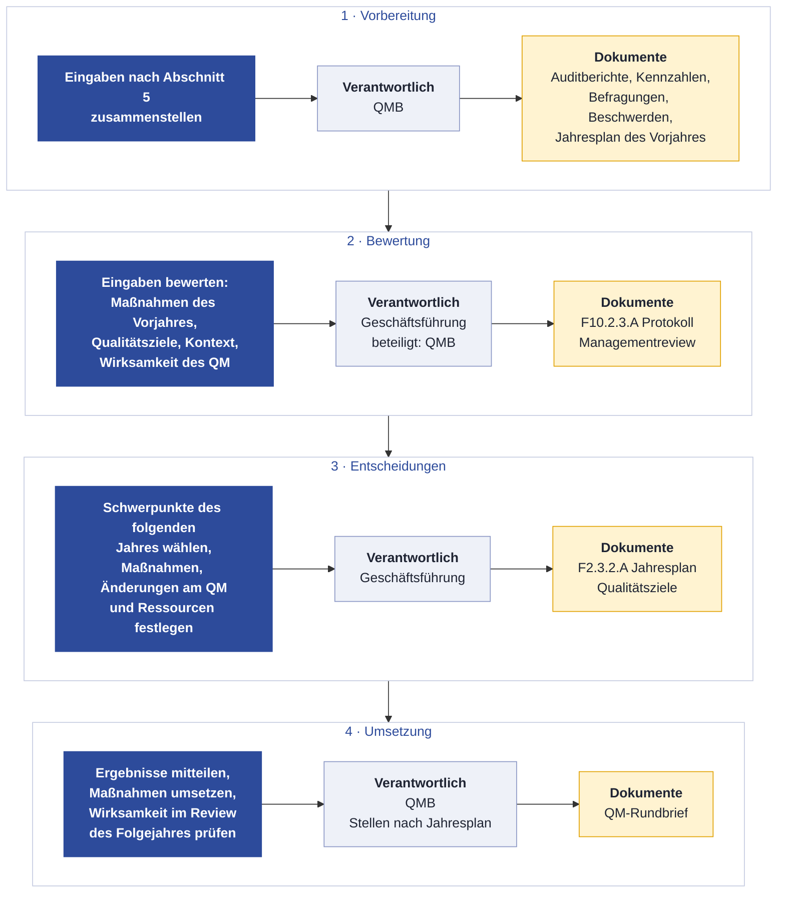

# 10.2.3 Managementreview

Kapitel: 10 Kontinuierliche Qualitätsverbesserung · 10.2 Qualitätsprüfungen · Kennung: 10.2.3 · Revision: 0001 (Entwurf) · Stand: 20.11.2026

Zugeordnete Prozesse: Managementprozess QM

Leitorientierung: Einmal im Jahr, vor dem externen Audit, bewertet die Geschäftsführung, ob das QM der Arbeit nützt: Was zeigen Audits, Beschwerden, Befragungen und Kennzahlen, was wurde aus den Maßnahmen des Vorjahres, was ist als Nächstes zu tun? Das Ergebnis ist der Jahresplan.

## 1 Ablauf

Lesart: je Zeile ein Abschnitt des Ablaufs; links der Prozessschritt (blau), in der Mitte die Verantwortung (hellblau), rechts die Dokumente (gelb). Das Dokument ist neu und ohne Vorlage; es stellt zusammen, was die überführten Dokumente über das Managementreview sagen, und ist insgesamt ein Vorschlag, der vom Träger nicht bestätigt ist.

## 2 Checkliste

### Vorbereitung

- [ ] Berichte der internen Audits des Jahres und Bericht des letzten externen Audits liegen vor
- [ ] Jahresplan des Vorjahres mit Stand der Maßnahmen liegt vor
- [ ] Kennzahlen, Befragungen, Wohlfühlindex und Auswertung der Beschwerden liegen vor
- [ ] Veränderungen im Kontext und bei den interessierten Parteien zusammengestellt
- [ ] Rückmeldungen der Mitarbeitenden an die QMB zusammengestellt

### Bewertung und Entscheidungen

- [ ] Jede Maßnahme des Vorjahres bewertet: erfüllt, teilweise erfüllt, nicht erfüllt
- [ ] Qualitätspolitik, Qualitätsziele und Kontext überprüft
- [ ] Zwei oder drei Schwerpunkte für das folgende Jahr gewählt
- [ ] Jahresplan ausgefüllt: Maßnahme, Ressourcen, verantwortliche Stelle, Termin, Nachweis
- [ ] Protokoll erstellt

### Umsetzung

- [ ] Ergebnisse im QM-Rundbrief mitgeteilt
- [ ] Protokoll und Jahresplan für das externe Audit bereitgestellt

## 3 Zugehörige Dokumente, Formulare und Rechtsgrundlagen

| Art | Bezeichnung | Fundstelle |
|---|---|---|
| Norm | ISO 9001:2015, Abschnitt 9.3 Managementbewertung | liegt dem Träger vor |
| QM-Handbuch | 2.3.1 Qualitätspolitik; 2.3.2 Qualitätsziele; 2.3.3 Kontext der Organisation | QM-Handbuch |
| QM-Handbuch | 10.2.1 Interne Audits; 10.2.2 Externe Audits | QM-Handbuch |
| QM-Handbuch | 10.1 Befragungen; 10.6 Kennzahlen; 8.9.2 Dokumentation Kundenzufriedenheit | noch nicht überführt |
| Formular | F2.3.2.A Jahresplan Qualitätsziele | QM-Handbuch |
| Formular | F10.2.3.A Protokoll Managementreview | OFFEN |

## 4 Zweck und Zuständigkeit

| | |
|---|---|
| Zweck | Jährliche Bewertung durch die Geschäftsführung, ob das QM-System geeignet, angemessen und wirksam ist und zur Ausrichtung des Trägers passt |
| verantwortlich | Geschäftsführung |
| beteiligt | QMB |
| Norm | ISO 9001:2015 |

## 5 Eingaben

| Eingabe | Quelle | Fundstelle |
|---|---|---|
| Stand der Maßnahmen aus dem Review des Vorjahres | Jahresplan des Vorjahres | 2.3.2, Abschnitt 3; F2.3.2.A |
| Grad der Erfüllung der Qualitätsziele | Nachweise zu den acht Zielen | 2.3.2, Abschnitt 2 |
| Veränderungen bei externen und internen Themen | jährliche Überprüfung | 2.3.3, Abschnitte 2, 3 und 5 |
| Zufriedenheit und Rückmeldungen der jungen Menschen, Familien und weiteren Parteien | Wohlfühlindex; Befragungen; Dialoge mit den Jugendämtern; Aussagen der Jugendämter in myJugendhilfe | 2.3.2; 10.1; 8.9.2 |
| Beschwerden | jährliche Auswertung der Beschwerdeursachen | 2.3.2, Ziel 6 |
| Ergebnisse der Audits und Stand der Maßnahmen daraus | Auditberichte; Maßnahmenpläne | 10.2.1; 10.2.2 |
| Kennzahlen | Kennzahlenmatrix | 10.6 |
| Rückmeldungen der Mitarbeitenden zum QM | Rückmeldungen an die QMB; Leitfragen der Dokumente | Teil „Reflexion und Weiterentwicklung“ jedes Dokuments |
| Wirksamkeit der Maßnahmen zu Risiken | Risikobetrachtungen der Dokumente | Teil „Risikobetrachtung“ jedes Dokuments |

## 6 Ergebnisse

1. Bewertung jeder Maßnahme des Vorjahres als erfüllt, teilweise erfüllt oder nicht erfüllt.
2. Zwei oder drei Qualitätsziele als Schwerpunkt des folgenden Jahres, festgehalten im Jahresplan (F2.3.2.A).
3. Entscheidungen über Änderungen am QM-System: Dokumente, die geändert werden oder entfallen.
4. Entscheidungen über Ressourcen.
5. Wo die Überprüfung es ergibt: Anpassung von Qualitätspolitik, Qualitätszielen und Kontext.

Die Ergebnisse werden im Protokoll festgehalten und im QM-Rundbrief mitgeteilt.

## Risikobetrachtung

Risiko: Das Review wird nur für das Audit geschrieben und bleibt ohne Folgen. Die Eingaben liegen nicht rechtzeitig vor.

Risikominimierung: fester Termin vor dem externen Audit; Jahresplan mit verantwortlicher Stelle und Termin; Prüfung der Wirksamkeit im Review des Folgejahres.

## Reflexion und Weiterentwicklung

Leitfragen für die Geschäfts- und Fachleitung:

1. Welche Entscheidung des letzten Reviews hat die praktische Arbeit spürbar verändert?
2. Welche Eingabe fehlt regelmäßig oder kommt zu spät?
3. Was am QM kostet mehr Zeit, als es nützt?

Ort der Reflexion: je nach Thema und Handlungsebene. Rückmeldungen gehen an die Qualitätsmanagementbeauftragte oder den Qualitätsmanagementbeauftragten (QMB).

## Offene Punkte

OFFEN: Das Dokument ist insgesamt ein Vorschlag. Vom Träger festgelegt sind nur: Das Managementreview ist ein eigener Vorgang neben den Auditberichten; der Begriff; die Geschäftsführung wählt jährlich zwei oder drei Schwerpunkte (2.3.2).

OFFEN: Kennung 10.2.3 und Einordnung unter 10.2 Qualitätsprüfungen.

OFFEN: Zeitpunkt: wie viele Wochen vor dem externen Audit; Termin, bis zu dem die Eingaben der QMB vorliegen.

OFFEN: Beteiligte neben Geschäftsführung und QMB, zum Beispiel Fachbereichsleitungen oder QM-Zirkel.

OFFEN: Form des Nachweises: Protokoll als Formular F10.2.3.A oder freier Bericht. Wie das Managementreview bisher dokumentiert wurde.

OFFEN: Eingaben, die die Norm nennt und zu denen das Handbuch bisher keine Quelle hat: Leistung externer Anbieter (Dienstleister, Lieferanten); Angemessenheit der Ressourcen.

OFFEN: 10.1, 10.6 und 8.9.2 sind nicht überführt; ob Befragungen, Kennzahlen und die Dokumentation in myJugendhilfe so durchgeführt werden, ist nicht bestätigt. Der Wohlfühlindex ist in keinem Dokument beschrieben.

OFFEN: 10.3 Optimierungsmanagement, 10.4 Qualitätszirkel und 10.5 Statistische Auswertungen liegen nicht vor; ihr Verhältnis zum Managementreview ist zu klären.

OFFEN: Erstellende Stelle und Verteiler.

## Änderungen

| Revision | Datum | Änderung | Grund |
|---|---|---|---|
| 0001 (Entwurf) | 20.11.2026 | Neu angelegt; zusammengestellt aus 2.3.1, 2.3.2, 2.3.3, 8.9.3, 10.2.1 und 10.2.2; Eingaben und Ergebnisse nach der Norm in eigenen Worten | Festlegung des Trägers vom 20.11.2026 (Standard, Nr. 33) |

Befunde: `befunde-gliederung.md`, Nr. 93 und 100.
