# 3.1.2 Prozesslandkarte

Kapitel: 3 Betriebliche Organisation und Verantwortungen · Kennung: 3.1.2 · Stand der Vorlage: 29.04.2026 · Version 04.2026, Rev. 001 · erstellt von: H. Wenkel · genehmigt von: Gf

Zugeordnete Prozesse: OFFEN

OFFEN: Die Prozesslandkarte ordnet alle Prozesse; welche Angabe in der Zeile „Zugeordnete Prozesse“ bei diesem Dokument steht, ist nicht festgelegt.

Übernommen am 19.11.2026 aus der Vorlage `alt/3.1.2_Prozesslandkarte.docx`. Prozessnamen stehen im Wortlaut der Vorlage; sie sind nicht berichtigt. Befunde stehen in `befunde-gliederung.md`, Abschnitt 5.

## 1 Aufbau

Die Prozesslandkarte zeigt drei Prozessarten: Managementprozesse (oben), „Lineare und systemische Kernprozesse“ (Mitte), Unterstützungsprozesse (unten). Zwei Pfeile mit den Beschriftungen „Beteiligung“ und „Transparenz“ rahmen die Kernprozesse und verbinden sie mit den Management- und den Unterstützungsprozessen.

```mermaid
flowchart TB
    subgraph M["Managmentprozesse"]
        direction LR
        M1["Leitbild, Konzeption"]
        M2["Finanzen und Controling"]
        M3["Personalführung und-entwickling"]
        M4["Kommunikation und Gremien"]
        M5["Verträge und Kooperationen"]
        M6["QM"]
        M7["Fort- und Weiterbildung"]
    end
    subgraph K["Lineare und systemische Kernprozesse"]
        direction LR
        subgraph KA["Ambulante Jugendhilfe"]
            direction TB
            KA1["Hilfeaufnahme"] --> KA2["Hilfeplanung"] --> KA3["Hilfeverlauf"] --> KA4["Beendigung der Hilfe"]
        end
        subgraph KS["Stationäre Hilfen"]
            direction TB
            KS1["Neuaufnahme"] --> KS2["Hilfeplanung"] --> KS3["schulischer Bereich"] --> KS4["Freizeitbereich"] --> KS5["Elternarbeit"] --> KS6["Entlassung"]
        end
        subgraph KT["teilstationäre Hilfen"]
            direction TB
            KT1["Neuaufnahme"] --> KT2["Hilfeplanung"] --> KT3["schulischer Bereich"] --> KT4["Freizeitbereich"] --> KT5["Elternarbeit"] --> KT6["Entlassung"]
        end
    end
    subgraph U["Unterstützungsprozesse"]
        direction LR
        U1["Verwaltung"]
        U2["Rechnungswesen, Buchhaltung"]
        U3["Personalabteilung"]
        U4["IT"]
        U5["Haustechnik"]
        U6["externe Lieferanten"]
    end
    M <-->|"Beteiligung · Transparenz"| K
    K <-->|"Beteiligung · Transparenz"| U
```

Die Verbindungslinien innerhalb der Kernprozesse geben die Reihenfolge der Vorlage wieder; die Vorlage zeigt dort eine Liste, keine Ablaufpfeile.

## 2 Prozesse

### 2.1 Managementprozesse

| Prozess (Wortlaut der Vorlage) |
|---|
| Leitbild, Konzeption |
| Finanzen und Controling |
| Personalführung und-entwickling |
| Kommunikation und Gremien |
| Verträge und Kooperationen |
| QM |
| Fort- und Weiterbildung |

### 2.2 Lineare und systemische Kernprozesse

| Ambulante Jugendhilfe | Stationäre Hilfen | teilstationäre Hilfen |
|---|---|---|
| Hilfeaufnahme | Neuaufnahme | Neuaufnahme |
| Hilfeplanung | Hilfeplanung | Hilfeplanung |
| Hilfeverlauf | schulischer Bereich | schulischer Bereich |
| Beendigung der Hilfe | Freizeitbereich | Freizeitbereich |
| | Elternarbeit | Elternarbeit |
| | Entlassung | Entlassung |

### 2.3 Unterstützungsprozesse

| Prozess (Wortlaut der Vorlage) |
|---|
| Verwaltung |
| Rechnungswesen, Buchhaltung |
| Personalabteilung |
| IT |
| Haustechnik |
| externe Lieferanten |

## Reflexion und Weiterentwicklung

OFFEN: Die Vorlage enthält keinen Teil „Reflexion und Weiterentwicklung“. Leitfragen, Ort der Reflexion und Weg der Rückmeldung legt der Träger fest.

## Änderungen

| Version | Datum | Änderung | Grund |
|---|---|---|---|
| 04.2026, Rev. 001 | 29.04.2026 | Stand der Vorlage | – |
