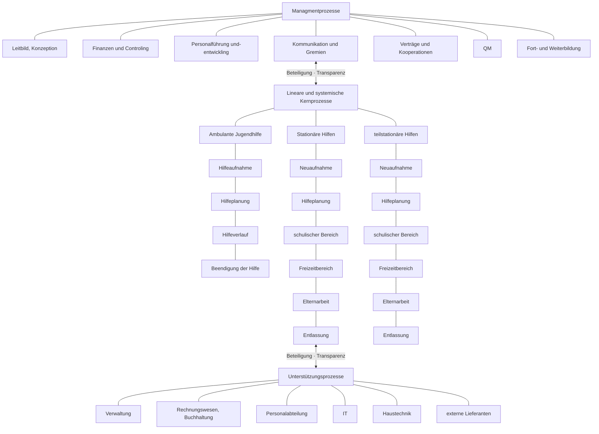

# 3.1.2 Prozesslandkarte

Kapitel: 3 Betriebliche Organisation und Verantwortungen · Kennung: 3.1.2 · Stand der Vorlage: 29.04.2026 · Version 04.2026, Rev. 001 · erstellt von: H. Wenkel · genehmigt von: Gf

Zugeordnete Prozesse: OFFEN

OFFEN: Die Prozesslandkarte ordnet alle Prozesse; welche Angabe in der Zeile „Zugeordnete Prozesse“ bei diesem Dokument steht, ist nicht festgelegt.

Übernommen am 19.11.2026 aus der Vorlage `alt/3.1.2_Prozesslandkarte.docx`. Prozessnamen stehen im Wortlaut der Vorlage; sie sind nicht berichtigt. Befunde stehen in `befunde-gliederung.md`, Abschnitt 5.

## 1 Aufbau

Die Prozesslandkarte zeigt drei Prozessarten: Managementprozesse (oben), „Lineare und systemische Kernprozesse“ (Mitte), Unterstützungsprozesse (unten). Zwei Pfeile mit den Beschriftungen „Beteiligung“ und „Transparenz“ rahmen die Kernprozesse und verbinden sie mit den Management- und den Unterstützungsprozessen.

Die Linien innerhalb der Kernprozesse geben die Reihenfolge der Vorlage wieder, keinen Ablauf. Die Pfeile „Beteiligung · Transparenz“ verbinden die drei Prozessarten als Ganzes; dass sie an einzelnen Kästen ansetzen, ist der Darstellung in Mermaid geschuldet.

## 2 Prozesse

Die Vorlage führt keine Prozessnummern. Der Träger hat am 19.11.2026 festgelegt, Nummern einzuführen. Die Nummern dieser Tabellen sind ein Vorschlag (Standard, Abschnitt 3.1) und noch nicht bestätigt.

### 2.1 Managementprozesse

| Nr. (Vorschlag) | Prozess (Wortlaut der Vorlage) |
|---|---|
| M1 | Leitbild, Konzeption |
| M2 | Finanzen und Controling |
| M3 | Personalführung und-entwickling |
| M4 | Kommunikation und Gremien |
| M5 | Verträge und Kooperationen |
| M6 | QM |
| M7 | Fort- und Weiterbildung |

### 2.2 Lineare und systemische Kernprozesse

| Nr. (Vorschlag) | Bereich | Prozess (Wortlaut der Vorlage) |
|---|---|---|
| K1 | Ambulante Jugendhilfe | – |
| K1.1 | Ambulante Jugendhilfe | Hilfeaufnahme |
| K1.2 | Ambulante Jugendhilfe | Hilfeplanung |
| K1.3 | Ambulante Jugendhilfe | Hilfeverlauf |
| K1.4 | Ambulante Jugendhilfe | Beendigung der Hilfe |
| K2 | Stationäre Hilfen | – |
| K2.1 | Stationäre Hilfen | Neuaufnahme |
| K2.2 | Stationäre Hilfen | Hilfeplanung |
| K2.3 | Stationäre Hilfen | schulischer Bereich |
| K2.4 | Stationäre Hilfen | Freizeitbereich |
| K2.5 | Stationäre Hilfen | Elternarbeit |
| K2.6 | Stationäre Hilfen | Entlassung |
| K3 | teilstationäre Hilfen | – |
| K3.1 | teilstationäre Hilfen | Neuaufnahme |
| K3.2 | teilstationäre Hilfen | Hilfeplanung |
| K3.3 | teilstationäre Hilfen | schulischer Bereich |
| K3.4 | teilstationäre Hilfen | Freizeitbereich |
| K3.5 | teilstationäre Hilfen | Elternarbeit |
| K3.6 | teilstationäre Hilfen | Entlassung |

### 2.3 Unterstützungsprozesse

| Nr. (Vorschlag) | Prozess (Wortlaut der Vorlage) |
|---|---|
| U1 | Verwaltung |
| U2 | Rechnungswesen, Buchhaltung |
| U3 | Personalabteilung |
| U4 | IT |
| U5 | Haustechnik |
| U6 | externe Lieferanten |

## Reflexion und Weiterentwicklung

OFFEN: Die Vorlage enthält keinen Teil „Reflexion und Weiterentwicklung“. Leitfragen, Ort der Reflexion und Weg der Rückmeldung legt der Träger fest.

## Änderungen

| Version | Datum | Änderung | Grund |
|---|---|---|---|
| 04.2026, Rev. 001 | 29.04.2026 | Stand der Vorlage | – |
