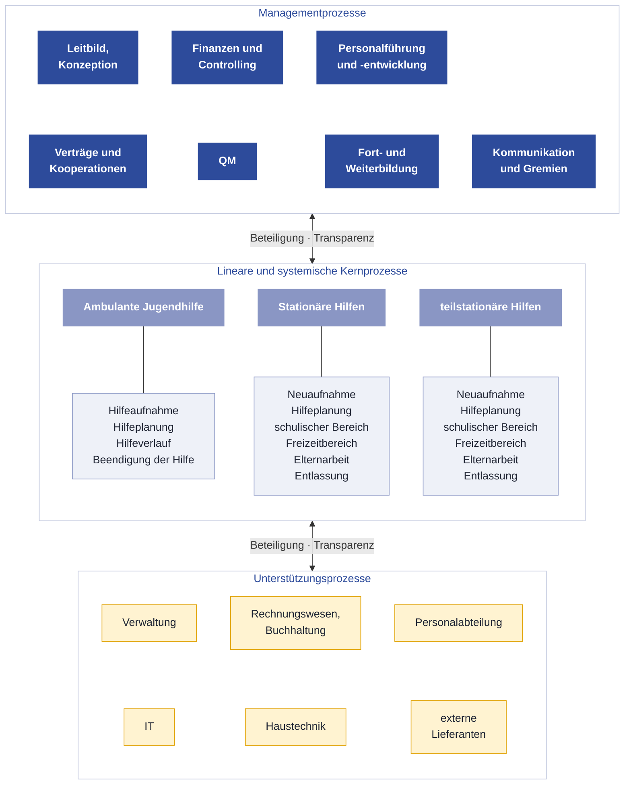

# 3.1.2 Prozesslandkarte

Kapitel: 3 Betriebliche Organisation und Verantwortungen · 3.1 Firmenübersichten · Kennung: 3.1.2 · Revision: 002 (Entwurf) · Stand: 19.11.2026

Zugeordnete Prozesse: OFFEN

Leitorientierung: Die Prozesslandkarte zeigt alle Prozesse des Trägers auf einem Blatt: Managementprozesse, Kernprozesse der ambulanten, stationären und teilstationären Hilfen und Unterstützungsprozesse. Beteiligung und Transparenz verbinden sie.

OFFEN: Die Prozesslandkarte ordnet alle Prozesse; welche Angabe in der Zeile „Zugeordnete Prozesse“ bei diesem Dokument steht, ist nicht festgelegt.

## 1 Aufbau

Die Prozesslandkarte zeigt drei Prozessarten: Managementprozesse (oben), „Lineare und systemische Kernprozesse“ (Mitte), Unterstützungsprozesse (unten). Zwei Pfeile mit den Beschriftungen „Beteiligung“ und „Transparenz“ rahmen die Kernprozesse und verbinden sie mit den Management- und den Unterstützungsprozessen.

Lesart: oben die Managementprozesse (blau), in der Mitte die Kernprozesse je Bereich (hellblau), unten die Unterstützungsprozesse (gelb). Die Reihenfolge der Kernprozesse je Bereich folgt der Vorlage.

## 2 Prozesse

Die Prozesse tragen keine eigenen Nummern. Sie sind im Handbuch beschrieben und werden mit Bereich und Namen benannt (Festlegung des Trägers vom 20.11.2026).

### 2.1 Managementprozesse

| Prozess |
|---|
| Leitbild, Konzeption |
| Finanzen und Controlling |
| Personalführung und -entwicklung |
| Kommunikation und Gremien |
| Verträge und Kooperationen |
| QM |
| Fort- und Weiterbildung |

### 2.2 Lineare und systemische Kernprozesse

| Bereich | Prozess |
|---|---|
| Ambulante Jugendhilfe | Hilfeaufnahme |
| Ambulante Jugendhilfe | Hilfeplanung |
| Ambulante Jugendhilfe | Hilfeverlauf |
| Ambulante Jugendhilfe | Beendigung der Hilfe |
| Stationäre Hilfen | Neuaufnahme |
| Stationäre Hilfen | Hilfeplanung |
| Stationäre Hilfen | schulischer Bereich |
| Stationäre Hilfen | Freizeitbereich |
| Stationäre Hilfen | Elternarbeit |
| Stationäre Hilfen | Entlassung |
| teilstationäre Hilfen | Neuaufnahme |
| teilstationäre Hilfen | Hilfeplanung |
| teilstationäre Hilfen | schulischer Bereich |
| teilstationäre Hilfen | Freizeitbereich |
| teilstationäre Hilfen | Elternarbeit |
| teilstationäre Hilfen | Entlassung |

### 2.3 Unterstützungsprozesse

| Prozess |
|---|
| Verwaltung |
| Rechnungswesen, Buchhaltung |
| Personalabteilung |
| IT |
| Haustechnik |
| externe Lieferanten |

## Risikobetrachtung

Vorschlag; vom Träger nicht bestätigt.

Risiko: Prozesse der Praxis fehlen in der Prozesslandkarte oder heißen dort anders als im Handbuch.

Risikominimierung: Abgleich von Prozesslandkarte und Gliederung bei der Überprüfung mindestens jährlich zum Audit.

## Reflexion und Weiterentwicklung

OFFEN: Die Vorlage enthält keinen Teil „Reflexion und Weiterentwicklung“. Die Leitfragen legt der Träger fest.

Ort der Reflexion: je nach Thema und Handlungsebene. Rückmeldungen gehen an die Qualitätsmanagementbeauftragte oder den Qualitätsmanagementbeauftragten (QMB).

## Änderungen

| Revision | Datum | Änderung | Grund |
|---|---|---|---|
| 001 | 29.04.2026 | Stand der Vorlage (Version 04.2026; erstellt von H. Wenkel, genehmigt von Gf) | – |
| 002 (Entwurf) | 19.11.2026 | Überführung in Markdown; Schaubild als Mermaid-Text, farbig nach Prozessart; Prozesstabellen; Zeile „Zugeordnete Prozesse“ und Teil „Reflexion und Weiterentwicklung“ angelegt | Standard QM-Dokumente; Festlegungen des Trägers vom 19.11.2026 |
| 002 (Entwurf) | 19.11.2026 | Schreibfehler berichtigt: „Managementprozesse“, „Controlling“, „Personalführung und -entwicklung“ | Schreibregeln des Trägers |
| 002 (Entwurf) | 20.11.2026 | Vorgeschlagene Prozessnummern entfernt; Risikobetrachtung ergänzt; Lenkung eingetragen | Festlegungen des Trägers vom 20.11.2026 |

Vorlage: `alt/3.1.2_Prozesslandkarte.docx`. Befunde: `befunde-gliederung.md`, Abschnitt 5.
