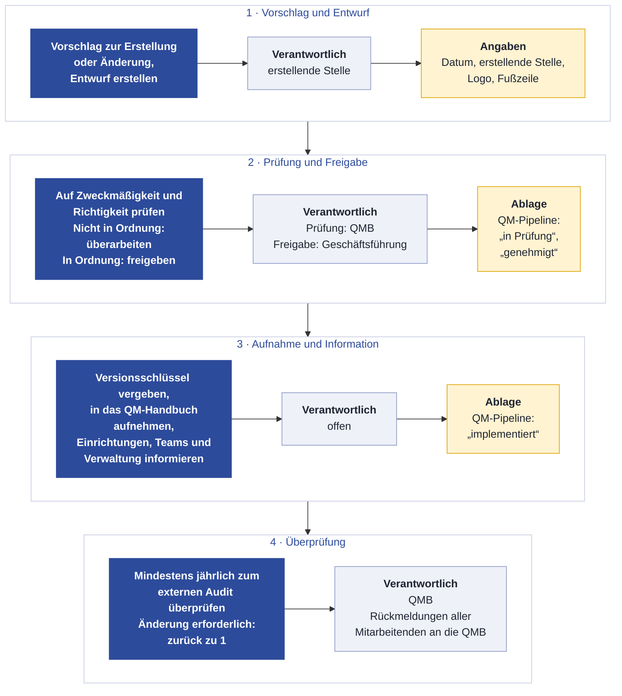

# 8.9.3 Lenkung von Formularen und Dokumenten

Kapitel: 8 Rahmenbedingungen · 8.9 Arbeitsanweisungen · Kennung: 8.9.3 · Revision: 0002 (Entwurf) · Stand: 20.11.2026

Zugeordnete Prozesse: Managementprozess QM

Leitorientierung: Jedes Dokument zeigt, wer es erstellt, geprüft und freigegeben hat und welche Fassung gilt. Die QMB prüft, die Geschäftsführung gibt frei. Gearbeitet wird immer mit der aktuellen Fassung; ein Entwurf gilt nicht.

## 1 Ablauf

Lesart: je Zeile ein Abschnitt des Ablaufs; links der Prozessschritt (blau), in der Mitte die Verantwortung (hellblau), rechts Angaben und Ablage (gelb).

## 2 Checkliste

### Entwurf

- [ ] Datum der Erstellung eingetragen
- [ ] Erstellende Stelle genannt
- [ ] Fußzeile mit „erstellt“, „geprüft“, „freigegeben“ und Revision vorhanden
- [ ] Logo des Trägers eingefügt
- [ ] Kennung vergeben; bei einem Formular: F, Kennung des zugehörigen Dokuments, Buchstabe

### Prüfung und Freigabe

- [ ] Von der QMB auf Zweckmäßigkeit und Richtigkeit geprüft
- [ ] Von der Geschäftsführung freigegeben
- [ ] Freigabevermerk mit Datum eingetragen

### Aufnahme und Information

- [ ] Revision hochgezählt, Stand eingetragen
- [ ] Neue Fassung in das QM-Handbuch aufgenommen, alte Fassung ersetzt
- [ ] Einrichtungen, Teams und Verwaltung informiert

### Überprüfung

- [ ] Zum externen Audit überprüft
- [ ] Rückmeldungen der Mitarbeitenden ausgewertet

## 3 Zugehörige Dokumente, Formulare und Rechtsgrundlagen

| Art | Bezeichnung | Fundstelle |
|---|---|---|
| Norm | ISO 9001:2015, Abschnitt 7.5 Dokumentierte Information | liegt dem Träger vor |
| Dokument | 5.2.1 CI-Konzept (Logo, Farben) | QM-Handbuch |
| Dokument | 8.9.4 Arbeitsanweisung Aufbewahrung personenbezogener Unterlagen | QM-Handbuch |
| Dokument | Anleitung für Mitarbeitende zum QM-Handbuch | QM-Handbuch |

## 4 Zweck und Zuständigkeit

| | |
|---|---|
| Zweck | Sicherstellen, dass alle Dokumente und Aufzeichnungen gekennzeichnet, geprüft und freigegeben sind und dass immer die aktuelle Fassung verwendet wird |
| Geltungsbereich | alle Mitarbeitenden |
| verantwortlich | Team- und Einrichtungsleitungen, Mitarbeitende der Verwaltung |
| beteiligt | alle Mitarbeitenden |
| Norm | ISO 9001:2015 |

## 5 Beschreibung

| Nr. | Beschreibung | verantwortlich | Dokumente/Formulare |
|---|---|---|---|
| 1 | Dokumentierte Information ist der Sammelbegriff der Norm für Dokumente, Daten, externe Dokumente, Formulare, Checklisten, Aufzeichnungen, Prozessbeschreibungen und Arbeitsanweisungen. Sie kann auf Papier oder elektronisch geführt und gelenkt werden. | | |
| 2 | Im Alltag werden unterschieden:; – Dokumente, zum Beispiel Formulare und Checklisten. Sie sind veränderbar. Dokumente des QM-Handbuchs durchlaufen die Prüfung nach Nr. 5.; – Aufzeichnungen, zum Beispiel Protokolle und Hilfepläne. Sie sind nicht veränderbar. | | |
| 3 | Mindestanforderungen an alle Dokumente und Aufzeichnungen des Trägers:; – Datum der Erstellung; – Verfasserin oder Verfasser erkennbar; – Logo des Trägers nach dem CI-Konzept | alle Mitarbeitenden | 5.2.1 CI-Konzept |
| 4 | QM-Dokumente und Formulare tragen zusätzlich eine Fußzeile mit den Angaben „erstellt“ (Mitarbeitende des Trägers), „geprüft“ (QMB), „freigegeben“ (Geschäftsführung) und der Version. | erstellende Stelle | |
| 5 | Weg eines QM-Dokuments: Vorschlag zur Erstellung oder Änderung, Entwurf, Prüfung auf Zweckmäßigkeit und Richtigkeit, Freigabe, Vergabe des Versionsschlüssels, Aufnahme in das QM-Handbuch, Information der Einrichtungen, Teams und der Verwaltung. Ist das Dokument in der Prüfung nicht in Ordnung, wird es überarbeitet. | QMB (Prüfung); Geschäftsführung (Freigabe) | Ordner „QM-Pipeline“ mit „in Prüfung“, „genehmigt“, „implementiert“ |
| 6 | Es wird immer die aktuelle Fassung verwendet. Ein Entwurf gilt nicht. | alle Mitarbeitenden | |
| 7 | Jedes QM-Dokument wird mindestens jährlich zum externen Audit überprüft. Sind Änderungen erforderlich, beginnt der Weg nach Nr. 5 neu. Rückmeldungen gehen an die QMB. | QMB | |

## Risikobetrachtung

Vorschlag; vom Träger nicht bestätigt.

Risiko: Mitarbeitende arbeiten mit einer veralteten Fassung oder mit einem Entwurf. Dokumente ohne Prüfung und Freigabe sind im Umlauf.

Risikominimierung: ein Fundort für die gültigen Fassungen; Information bei jeder neuen Fassung; Status „Entwurf“ sichtbar auf dem Dokument; Überprüfung jährlich zum externen Audit.

## Reflexion und Weiterentwicklung

Vorschlag; vom Träger nicht bestätigt.

Leitfragen:

1. Wo wurde im vergangenen Jahr mit einer veralteten Fassung oder einem eigenen Formular gearbeitet, und warum?
2. Wie lange dauert der Weg vom Vorschlag bis zur gültigen Fassung, und wo stockt er?
3. Welches Dokument wird nicht genutzt und kann entfallen?

Ort der Reflexion: je nach Thema und Handlungsebene. Rückmeldungen gehen an die Qualitätsmanagementbeauftragte oder den Qualitätsmanagementbeauftragten (QMB).

## Offene Punkte

OFFEN: Verfasserin oder Verfasser: Die Vorlage verlangt, dass die Person aus jedem Dokument hervorgeht. Die überführten Dokumente nennen Stellen (zum Beispiel „Geschäftsführung, QMB“), keine Namen. Festzulegen ist, was gilt.

OFFEN: Version: Die Vorlage verlangt das Format „MM/JJJJ, Rev. xxxx“. Die überführten Dokumente führen Revision und Stand als Datum. Festzulegen ist, was gilt.

OFFEN: Verantwortlich für Versionsschlüssel, Aufnahme in das Handbuch und Information der Einrichtungen: in der Vorlage nicht genannt.

OFFEN: Ordner „QM-Pipeline“: ob er noch genutzt wird und wie er sich zur Arbeit im Repository verhält. Fundort der gültigen Fassungen für Mitarbeitende.

OFFEN: Art der Information über neue Fassungen und Frist dafür.

OFFEN: In der Vorlage nicht geregelt: Aufbewahrung und Vernichtung von Dokumenten und Aufzeichnungen (außer 8.9.4), Umgang mit ungültigen Fassungen, Dokumente externer Herkunft, Schutz vor Verlust und unbefugter Änderung.

OFFEN: Verantwortlich sind nach der Vorlage Team- und Einrichtungsleitungen sowie Mitarbeitende der Verwaltung; zu bestätigen. Erstellende Stelle dieses Dokuments.

OFFEN: 8.9.4 und 5.2.1 liegen im Repository nicht vor; die Verweise sind nach der Dateiliste gesetzt.

## Änderungen

| Revision | Datum | Änderung | Grund |
|---|---|---|---|
| 0001 | 02/2019 | Stand der Vorlage (zwei Seiten; erstellt und geprüft 07.02.2019, nicht freigegeben) | – |
| 0002 (Entwurf) | 20.11.2026 | Überführung in Markdown; Ablauf an erster Stelle, als Mermaid-Text; Checkliste, Verweise, Risikobetrachtung, Leitfragen und Leitorientierung ergänzt | Standard QM-Dokumente |
| 0002 (Entwurf) | 20.11.2026 | Ablauf an den Text angepasst: Freigabe durch die Geschäftsführung als Schritt aufgenommen (im Flussdiagramm der Vorlage nicht enthalten) | Text hat Vorrang (Standard, Nr. 11) |
| 0002 (Entwurf) | 20.11.2026 | „kontinuierlich überprüfen“ ersetzt durch „mindestens jährlich zum externen Audit“; ergänzt: Entwurf gilt nicht, Rückmeldungen an die QMB, Kennung der Formulare | Festlegungen des Trägers vom 20.11.2026 (Standard, Nr. 23, 32, 33) |
| 0002 (Entwurf) | 20.11.2026 | Bereinigt: „MitarbeiterInnen“ zu „Mitarbeitende“, Abkürzungen „SwS“, „MA“, „Gf“, „z.B.“, „usw.“, „s.u.“ ausgeschrieben oder entfernt; „grundsätzlich“ gestrichen; Erläuterung der Norm in eigenen Worten | Schreibregeln des Trägers |

Vorlage: `alt/8.9.3_AA_Lenkung_von_dok._Informationen.docx`. Befunde: `befunde-gliederung.md`, Nr. 90 und 91.
