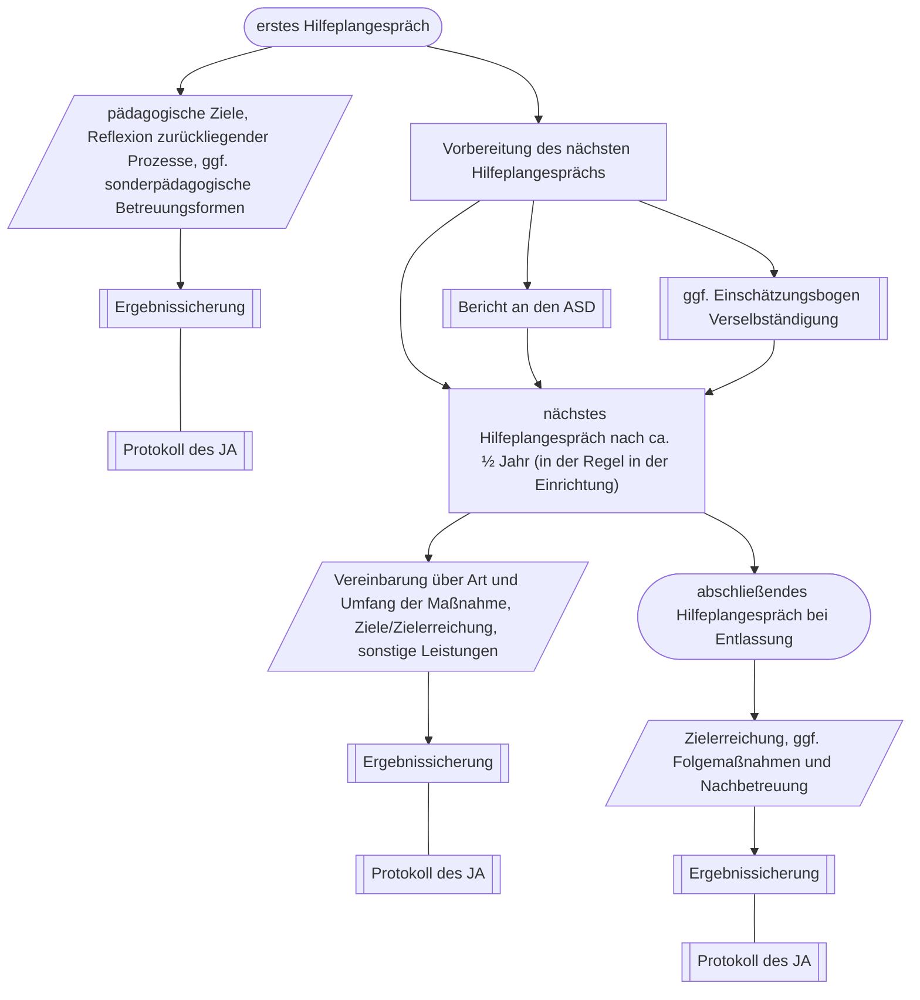

# 9.1.4 Hilfeplanung stat. Einr.

Kapitel: 9 Betreuungsprozesse · 9.1 Betreuungsprozesse stationäre Einrichtungen · Kennung: 9.1.4 · Revision: 0006 (Entwurf) · Stand: 19.11.2026

Zugeordnete Prozesse: K2.2 Hilfeplanung

Musterdokument der Überführung. Übernommen am 19.11.2026 aus den Vorlagen `alt/9.1.4_Hilfeplanung_stat._Einr.docx` (Text) und `alt/9.1.4_Hilfeplanung_stat._Einr._Flussdiagramm.pdf` (Flussdiagramm). Der Wortlaut der Vorlagen ist nicht berichtigt. Befunde stehen in `befunde-gliederung.md`, Abschnitt 6.

OFFEN: Die Prozessnummer K2.2 folgt dem Vorschlag im Standard, Abschnitt 3.1; das Nummernschema ist noch nicht bestätigt.

## 1 Zweck und Zuständigkeit

| | |
|---|---|
| Zweck | Feststellung und Fortschreibung von Bedarf, Art der Hilfe und Leistungen |
| verantwortlich | LeiterInnen der Einrichtungen, Personensorgeberechtigte |
| beteiligt | ASD, alle weiteren am Hilfeprozess Beteiligten |
| rechtliche Grundlagen | § 36 SGB VIII |

## 2 Beschreibung

| Nr. | Beschreibung | verantwortlich | Dokumente/Formulare |
|---|---|---|---|
| 1 | Hilfeplangespräche begleiten den Hilfeprozess während der Unterbringung. Sie finden zu Beginn der Maßnahme und - je nach Absprache - halbjährlich oder jährlich statt. Einladend und federführend ist das Jugendamt. Auf Vorschlag der Einrichtungen können im Einzelfall z.B. auch LehrerInnen bzw. AusbilderInnen teilnehmen. | LeiterInnen der Einrichtungen; Fachbereichsleitung; Erzieherteam | Dokumentation in myJugendhilfe, ggf. Aktenvermerk, Fragebogen Jugendamt |
| 2 | Gemeinsam sprechen die Beteiligten über pädagogische Ziele, reflektieren zurückliegende Prozesse, beraten auch über sonderpädagogische Betreuungsformen wie z.B. intensive Einzelbetreuung oder Zusatzangebote. | | |
| 3 | Ergebnis ist, dokumentiert durch das im Jugendamt erstellte HPG-Protokoll, eine schriftliche Vereinbarung über Art, Ziel, Umfang und Ort einer Maßnahme zur Hilfe zur Erziehung sowie über Zuständigkeiten/Verantwortlichkeiten und sonstige Leistungen. | | HPG-Protokoll des Jugendamtes (nicht hinterlegt) |
| 4 | Um auch bis zur Präsentation des HPG-Protokolls eine dokumentierte Grundlage für die Erziehungsplanung nutzen zu können, findet zunächst eine Ergebnissicherung durch die Einrichtung statt. | | |
| 5 | Die HPGs finden in der Regel in der Einrichtung statt (s. 9.5.1). | LeiterIn der Einrichtung | Vorbereitung auf das Hpg; Einschätzungsbogen Verselbständigung |
| 6 | In den Tagen vor dem HPG-Termin bereitet das Team im Rahmen der Erziehungsplanung das HPG vor. Über das Ergebnis dieser vorbereitenden Arbeit wird der ASD im Vorfeld schriftlich oder telefonisch informiert. | | |

OFFEN: Die Vorlage ordnet die Angaben der Spalten „verantwortlich“ und „Dokumente/Formulare“ keinem einzelnen Schritt zu; sie stehen hier nach ihrer Lage in der Vorlage. Die Zuordnung je Schritt legt der Träger fest.

OFFEN: Der Verweis „s. 9.5.1“ hat in der Gliederung kein Ziel.

## 3 Ablauf

Das Flussdiagramm der Vorlage trägt den Titel „Hilfeplanung Wohngruppe“.

Zeichen der Vorlage: abgerundete Form = Start/Ende; Rechteck mit Seitenstreifen = Teilprozess; Notiz = Inhalte; Wellenform = Dokument. In der Mermaid-Fassung stehen Inhalte als Parallelogramm, Dokumente als Rechteck mit Doppelrand, Teilprozesse als Rechteck.

## 4 Risikobetrachtung

Risiko: Da das Jugendamt für den Hilfeplanprozess federführend ist, kann es zu unterschiedlichen Auffassungen und mangelnder Abstimmung bezüglich des Betreuungsprozesses zwischen Jugendamt und Einrichtung kommen.

Risikominimierung: Ein enger Kontakt zum Jugendamt ist unerlässlich. Klare Absprachen, rechtzeitige Ergebnissicherung von HPG und transparente Vermittlung der Ergebnisse für Klienten und Familie reduzieren Missverständnisse.

## Reflexion und Weiterentwicklung

Vorschlag nach dem Standard, Abschnitt 3.2; vom Träger nicht bestätigt.

Leitfragen zur Reflexion des Handelns:

1. Wie wurde das Hilfeplangespräch im Einzelfall vorbereitet, und wie wurde der junge Mensch daran beteiligt?
2. Was hat im Gespräch und in der Abstimmung mit dem Jugendamt getragen, was nicht?
3. Lag die Ergebnissicherung der Einrichtung rechtzeitig vor, und wurde sie für die Erziehungsplanung genutzt?
4. Wo wurde vom beschriebenen Vorgehen abgewichen, und mit welcher Begründung?
5. Wie haben der junge Mensch und die Familie das Gespräch und die Vermittlung der Ergebnisse erlebt?

OFFEN: Ort der Reflexion (z. B. Teamsitzung, Fallberatung, Supervision).

OFFEN: Weg der Rückmeldung an die für das Dokument verantwortliche Stelle.

## Änderungen

| Revision | Datum | Änderung | Grund |
|---|---|---|---|
| 0003 | 04/2011 | Stand des Flussdiagramms der Vorlage | – |
| 0005 | 04/2018 | Stand des Textes der Vorlage (erstellt und geprüft 30.04.18) | – |
| 0006 (Entwurf) | 19.11.2026 | Überführung in Markdown; Text und Flussdiagramm in einem Dokument; Zeile „Zugeordnete Prozesse“ und Teil „Reflexion und Weiterentwicklung“ ergänzt | Standard QM-Dokumente |
