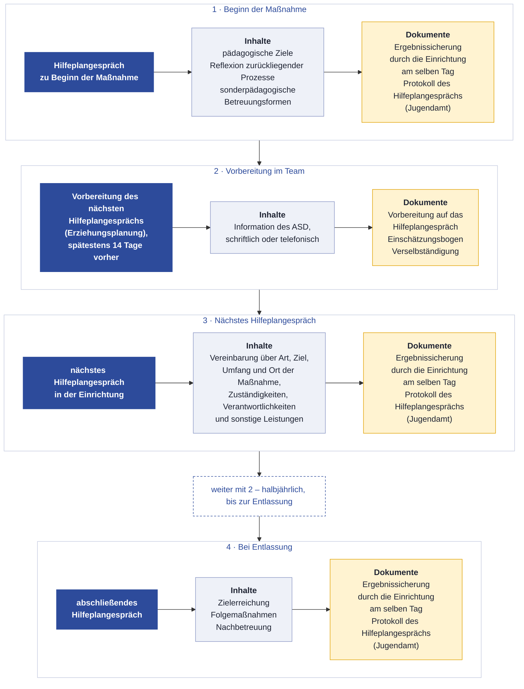

# 9.1.4 Hilfeplanung – stationäre Einrichtungen

Kapitel: 9 Hilfeprozesse · 9.1 Betreuungsprozesse stationäre Einrichtungen · Kennung: 9.1.4 · Revision: 0006 (Entwurf) · Stand: 20.11.2026

Zugeordnete Prozesse: Stationäre Hilfen: Hilfeplanung

Leitorientierung: Hilfeplangespräche finden zu Beginn der Maßnahme und danach halbjährlich statt; federführend ist das Jugendamt. Das Team bereitet jedes Gespräch spätestens 14 Tage vorher vor und informiert den ASD. Die Einrichtung sichert die Ergebnisse am selben Tag.

## 1 Ablauf

Lesart: je Zeile ein Abschnitt des Ablaufs; links der Prozessschritt (blau), in der Mitte die Inhalte (hellblau), rechts die Dokumente (gelb).

## 2 Checkliste

### Vor dem Hilfeplangespräch

- [ ] Spätestens 14 Tage vorher: Hilfeplangespräch im Team vorbereitet (Erziehungsplanung)
- [ ] Formular F9.1.4.A „Vorbereitung auf das Hilfeplangespräch“ ausgefüllt
- [ ] Formular F9.1.4.B „Einschätzungsbogen Verselbständigung“ ausgefüllt
- [ ] Spätestens 14 Tage vorher: ASD schriftlich oder telefonisch über das Ergebnis informiert
- [ ] Teilnahme von Lehrkräften oder Ausbildenden geprüft und dem Jugendamt vorgeschlagen

### Im Hilfeplangespräch

- [ ] Pädagogische Ziele besprochen
- [ ] Zurückliegende Prozesse reflektiert
- [ ] Sonderpädagogische Betreuungsformen beraten

### Nach dem Hilfeplangespräch

- [ ] Am selben Tag: Ergebnisse gesichert und in myJugendhilfe dokumentiert
- [ ] Ergebnisse dem jungen Menschen und der Familie vermittelt
- [ ] Protokoll des Jugendamts liegt vor
- [ ] Nächstes Hilfeplangespräch in sechs Monaten vorgemerkt

### Bei Entlassung

- [ ] Abschließendes Hilfeplangespräch geführt: Zielerreichung, Folgemaßnahmen, Nachbetreuung
- [ ] Am selben Tag: Ergebnisse gesichert und in myJugendhilfe dokumentiert

## 3 Zugehörige Dokumente, Formulare und Rechtsgrundlagen

| Art | Bezeichnung | Fundstelle |
|---|---|---|
| Rechtsgrundlage | § 36 SGB VIII Mitwirkung, Hilfeplan | [gesetze-im-internet.de](https://www.gesetze-im-internet.de/sgb_8/__36.html) |
| QM-Handbuch | 9.4.1 Hilfeplangespräch im Jugendamt | noch nicht überführt |
| Formular | F9.1.4.A Vorbereitung auf das Hilfeplangespräch | OFFEN |
| Formular | F9.1.4.B Einschätzungsbogen Verselbständigung | OFFEN |
| Formular | F9.1.4.C Fragebogen Jugendamt | OFFEN |
| Dokumentation | myJugendhilfe; Aktenvermerk bei Vorkommnissen und Entwicklungen über die tägliche Dokumentation hinaus | Fachsoftware |
| Dokument des Jugendamts | Protokoll des Hilfeplangesprächs | nicht hinterlegt |

## 4 Zweck und Zuständigkeit

| | |
|---|---|
| Zweck | Feststellung und Fortschreibung von Bedarf, Art der Hilfe und Leistungen |
| verantwortlich | Leitungen der Einrichtungen, Personensorgeberechtigte |
| beteiligt | Allgemeiner Sozialer Dienst (ASD), alle weiteren am Hilfeprozess Beteiligten |
| rechtliche Grundlagen | § 36 SGB VIII |

## 5 Beschreibung

| Nr. | Beschreibung | verantwortlich | Dokumente/Formulare |
|---|---|---|---|
| 1 | Hilfeplangespräche begleiten den Hilfeprozess während der Unterbringung. Sie finden zu Beginn der Maßnahme und danach halbjährlich statt. Einladend und federführend ist das Jugendamt. Auf Vorschlag der Einrichtung können auch Lehrkräfte oder Ausbildende teilnehmen. | Leitungen der Einrichtungen; Fachbereichsleitung; Team der Einrichtung | Dokumentation in myJugendhilfe; Aktenvermerk bei Vorkommnissen und Entwicklungen, die über die tägliche Dokumentation hinaus festgehalten werden müssen; Fragebogen Jugendamt |
| 2 | Gemeinsam sprechen die Beteiligten über pädagogische Ziele, reflektieren zurückliegende Prozesse und beraten auch über sonderpädagogische Betreuungsformen wie z. B. intensive Einzelbetreuung oder Zusatzangebote. | | |
| 3 | Ergebnis ist, dokumentiert durch das im Jugendamt erstellte Protokoll des Hilfeplangesprächs, eine schriftliche Vereinbarung über Art, Ziel, Umfang und Ort einer Maßnahme der Hilfe zur Erziehung sowie über Zuständigkeiten, Verantwortlichkeiten und sonstige Leistungen. | | Protokoll des Hilfeplangesprächs (Jugendamt, nicht hinterlegt) |
| 4 | Um auch bis zur Präsentation des Protokolls eine dokumentierte Grundlage für die Erziehungsplanung nutzen zu können, sichert die Einrichtung die Ergebnisse noch am Tag des Hilfeplangesprächs. | | |
| 5 | Die Hilfeplangespräche finden in der Einrichtung statt. Lädt das Jugendamt zu sich ein, gilt 9.4.1 Hilfeplangespräch im Jugendamt. | Leitung der Einrichtung | Vorbereitung auf das Hilfeplangespräch; Einschätzungsbogen Verselbständigung |
| 6 | Spätestens 14 Tage vor dem Termin bereitet das Team im Rahmen der Erziehungsplanung das Hilfeplangespräch vor und informiert den ASD schriftlich oder telefonisch über das Ergebnis. | | |
| 7 | Bei Entlassung findet ein abschließendes Hilfeplangespräch statt. Besprochen werden die Zielerreichung, Folgemaßnahmen und die Nachbetreuung. Die Einrichtung sichert die Ergebnisse am selben Tag. | | Protokoll des Hilfeplangesprächs (Jugendamt, nicht hinterlegt) |

## 6 Risikobetrachtung

Risiko: Da das Jugendamt für den Hilfeplanprozess federführend ist, kann es zu unterschiedlichen Auffassungen und mangelnder Abstimmung über den Betreuungsprozess zwischen Jugendamt und Einrichtung kommen.

Risikominimierung: Ein enger Kontakt zum Jugendamt ist unerlässlich. Klare Absprachen, Ergebnissicherung am Tag des Hilfeplangesprächs und transparente Vermittlung der Ergebnisse an den jungen Menschen und die Familie reduzieren Missverständnisse.

## Reflexion und Weiterentwicklung

Leitfragen zur Reflexion des Handelns:

1. Wie wurde das Hilfeplangespräch vorbereitet, und wie wurde der junge Mensch daran beteiligt?
2. Was hat im Gespräch und in der Abstimmung mit dem Jugendamt getragen, was nicht?
3. Lag die Ergebnissicherung der Einrichtung am Tag des Gesprächs vor, und wurde sie für die Erziehungsplanung genutzt?
4. Wo wurde vom beschriebenen Vorgehen abgewichen, und mit welcher Begründung?
5. Wie haben der junge Mensch und die Familie das Gespräch und die Vermittlung der Ergebnisse erlebt?

Ort der Reflexion: je nach Thema und Handlungsebene. Rückmeldungen gehen an die Qualitätsmanagementbeauftragte oder den Qualitätsmanagementbeauftragten (QMB).

## Offene Punkte

OFFEN: Stelle für „erstellt“ und Verteiler sind nicht benannt.

OFFEN: Die Formulare F9.1.4.A, F9.1.4.B und F9.1.4.C liegen im Repository nicht vor; ihr Ablageort fehlt. Ein Verweis ist erst damit möglich.

## Änderungen

| Revision | Datum | Änderung | Grund |
|---|---|---|---|
| 0003 | 04/2011 | Stand des Flussdiagramms der Vorlage | – |
| 0005 | 04/2018 | Stand des Textes der Vorlage (erstellt und geprüft 30.04.18) | – |
| 0006 (Entwurf) | 19.11.2026 | Überführung in Markdown; Text und Flussdiagramm in einem Dokument mit gemeinsamer Revision; Zeile „Zugeordnete Prozesse“ und Teil „Reflexion und Weiterentwicklung“ ergänzt | Standard QM-Dokumente |
| 0006 (Entwurf) | 19.11.2026 | Schreibweisen bereinigt (Paarform oder neutrale Form, Abkürzungen ausgeschrieben); Nummerierung der Beschreibung durchgezählt; Verweis 9.5.1 durch 9.4.1 ersetzt | Schreibregeln des Trägers; Festlegungen des Trägers vom 19.11.2026 |
| 0006 (Entwurf) | 19.11.2026 | Flussdiagramm an den Text angepasst und in drei Abschnitte mit Prozessschritt, Inhalten und Dokumenten gegliedert: Turnus „halbjährlich oder jährlich“ statt „nach ca. ½ Jahr“; „Information des ASD“ statt „Bericht an den ASD“; entfallen sind „abschließendes Hilfeplangespräch bei Entlassung“ sowie „Zielerreichung, ggf. Folgemaßnahmen und Nachbetreuung“ | Festlegung des Trägers vom 19.11.2026: Bei Abweichungen hat der Text Vorrang |
| 0006 (Entwurf) | 19.11.2026 | Unbestimmte Angaben ersetzt: Turnus halbjährlich; Ort Einrichtung, bei Einladung des Jugendamts 9.4.1; Vorbereitung und Information des ASD spätestens 14 Tage vor dem Termin; Ergebnissicherung am Tag des Gesprächs; „ggf.“, „im Einzelfall“, „z. B.“ gestrichen | Festlegungen des Trägers vom 19.11.2026 |
| 0006 (Entwurf) | 20.11.2026 | Aufbau geändert: Ablauf an erster Stelle; Checkliste aus der Beschreibung abgeleitet; Übersicht der zugehörigen Dokumente, Formulare und Rechtsgrundlagen mit Verweisen; offene Punkte in einem Abschnitt gesammelt | Festlegungen des Trägers vom 20.11.2026 |
| 0006 (Entwurf) | 20.11.2026 | Abschließendes Hilfeplangespräch bei Entlassung in Text, Ablauf und Checkliste aufgenommen; Aktenvermerk definiert; Prozessnummer entfallen; Kapitel 9 heißt Hilfeprozesse; Ort der Reflexion, Rückmeldung und Lenkung eingetragen | Festlegungen des Trägers vom 20.11.2026 |
| 0006 (Entwurf) | 20.11.2026 | Kennungen der Formulare: F9.1.4.A, F9.1.4.B, F9.1.4.C | Festlegung des Trägers vom 20.11.2026 |

Vorlagen: `alt/9.1.4_Hilfeplanung_stat._Einr.docx` (Text) und `alt/9.1.4_Hilfeplanung_stat._Einr._Flussdiagramm.pdf` (Flussdiagramm).
