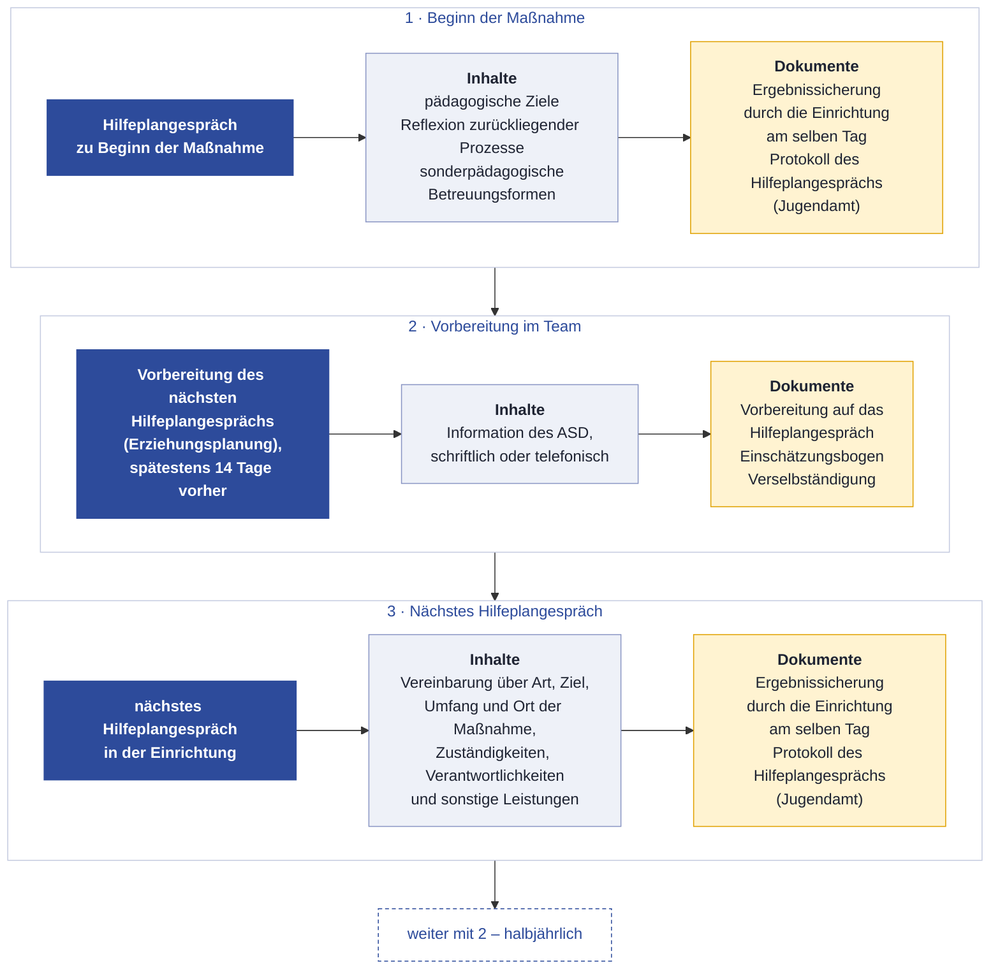

# 9.1.4 Hilfeplanung – stationäre Einrichtungen

Kapitel: 9 Betreuungsprozesse · 9.1 Betreuungsprozesse stationäre Einrichtungen · Kennung: 9.1.4 · Revision: 0006 (Entwurf) · Stand: 19.11.2026

Zugeordnete Prozesse: K2.2 Hilfeplanung

OFFEN: Die Prozessnummer K2.2 folgt dem Vorschlag im Standard, Abschnitt 3.1; das Nummernschema ist noch nicht bestätigt.

OFFEN: Stellen für „erstellt“, „geprüft“ und „freigegeben“, Verteiler und Zeitpunkt der nächsten Überprüfung sind nicht benannt.

## 1 Zweck und Zuständigkeit

| | |
|---|---|
| Zweck | Feststellung und Fortschreibung von Bedarf, Art der Hilfe und Leistungen |
| verantwortlich | Leitungen der Einrichtungen, Personensorgeberechtigte |
| beteiligt | Allgemeiner Sozialer Dienst (ASD), alle weiteren am Hilfeprozess Beteiligten |
| rechtliche Grundlagen | § 36 SGB VIII |

## 2 Beschreibung

| Nr. | Beschreibung | verantwortlich | Dokumente/Formulare |
|---|---|---|---|
| 1 | Hilfeplangespräche begleiten den Hilfeprozess während der Unterbringung. Sie finden zu Beginn der Maßnahme und danach halbjährlich statt. Einladend und federführend ist das Jugendamt. Auf Vorschlag der Einrichtung können auch Lehrkräfte oder Ausbildende teilnehmen. | Leitungen der Einrichtungen; Fachbereichsleitung; Team der Einrichtung | Dokumentation in myJugendhilfe, Aktenvermerk, Fragebogen Jugendamt |
| 2 | Gemeinsam sprechen die Beteiligten über pädagogische Ziele, reflektieren zurückliegende Prozesse und beraten auch über sonderpädagogische Betreuungsformen wie z. B. intensive Einzelbetreuung oder Zusatzangebote. | | |
| 3 | Ergebnis ist, dokumentiert durch das im Jugendamt erstellte Protokoll des Hilfeplangesprächs, eine schriftliche Vereinbarung über Art, Ziel, Umfang und Ort einer Maßnahme der Hilfe zur Erziehung sowie über Zuständigkeiten, Verantwortlichkeiten und sonstige Leistungen. | | Protokoll des Hilfeplangesprächs (Jugendamt, nicht hinterlegt) |
| 4 | Um auch bis zur Präsentation des Protokolls eine dokumentierte Grundlage für die Erziehungsplanung nutzen zu können, sichert die Einrichtung die Ergebnisse noch am Tag des Hilfeplangesprächs. | | |
| 5 | Die Hilfeplangespräche finden in der Einrichtung statt. Lädt das Jugendamt zu sich ein, gilt 9.4.1 Hilfeplangespräch im Jugendamt. | Leitung der Einrichtung | Vorbereitung auf das Hilfeplangespräch; Einschätzungsbogen Verselbständigung |
| 6 | Spätestens 14 Tage vor dem Termin bereitet das Team im Rahmen der Erziehungsplanung das Hilfeplangespräch vor und informiert den ASD schriftlich oder telefonisch über das Ergebnis. | | |

OFFEN: Die Vorlage nennt den Aktenvermerk mit „ggf.“. In welchen Fällen er angelegt wird, ist nicht festgelegt.

## 3 Ablauf

Lesart: je Zeile ein Abschnitt des Ablaufs; links der Prozessschritt (blau), in der Mitte die Inhalte (hellblau), rechts die Dokumente (gelb).

## 4 Risikobetrachtung

Risiko: Da das Jugendamt für den Hilfeplanprozess federführend ist, kann es zu unterschiedlichen Auffassungen und mangelnder Abstimmung über den Betreuungsprozess zwischen Jugendamt und Einrichtung kommen.

Risikominimierung: Ein enger Kontakt zum Jugendamt ist unerlässlich. Klare Absprachen, Ergebnissicherung am Tag des Hilfeplangesprächs und transparente Vermittlung der Ergebnisse an den jungen Menschen und die Familie reduzieren Missverständnisse.

## Reflexion und Weiterentwicklung

Leitfragen zur Reflexion des Handelns:

1. Wie wurde das Hilfeplangespräch vorbereitet, und wie wurde der junge Mensch daran beteiligt?
2. Was hat im Gespräch und in der Abstimmung mit dem Jugendamt getragen, was nicht?
3. Lag die Ergebnissicherung der Einrichtung am Tag des Gesprächs vor, und wurde sie für die Erziehungsplanung genutzt?
4. Wo wurde vom beschriebenen Vorgehen abgewichen, und mit welcher Begründung?
5. Wie haben der junge Mensch und die Familie das Gespräch und die Vermittlung der Ergebnisse erlebt?

OFFEN: Ort der Reflexion (z. B. Teamsitzung, Fallberatung, Supervision).

OFFEN: Weg der Rückmeldung an die für das Dokument verantwortliche Stelle.

## Änderungen

| Revision | Datum | Änderung | Grund |
|---|---|---|---|
| 0003 | 04/2011 | Stand des Flussdiagramms der Vorlage | – |
| 0005 | 04/2018 | Stand des Textes der Vorlage (erstellt und geprüft 30.04.18) | – |
| 0006 (Entwurf) | 19.11.2026 | Überführung in Markdown; Text und Flussdiagramm in einem Dokument mit gemeinsamer Revision; Zeile „Zugeordnete Prozesse“ und Teil „Reflexion und Weiterentwicklung“ ergänzt | Standard QM-Dokumente |
| 0006 (Entwurf) | 19.11.2026 | Schreibweisen bereinigt (Paarform oder neutrale Form, Abkürzungen ausgeschrieben); Nummerierung der Beschreibung durchgezählt; Verweis 9.5.1 durch 9.4.1 ersetzt | Schreibregeln des Trägers; Festlegungen des Trägers vom 19.11.2026 |
| 0006 (Entwurf) | 19.11.2026 | Flussdiagramm an den Text angepasst und in drei Abschnitte mit Prozessschritt, Inhalten und Dokumenten gegliedert: Turnus „halbjährlich oder jährlich“ statt „nach ca. ½ Jahr“; „Information des ASD“ statt „Bericht an den ASD“; entfallen sind „abschließendes Hilfeplangespräch bei Entlassung“ sowie „Zielerreichung, ggf. Folgemaßnahmen und Nachbetreuung“ | Festlegung des Trägers vom 19.11.2026: Bei Abweichungen hat der Text Vorrang |
| 0006 (Entwurf) | 19.11.2026 | Unbestimmte Angaben ersetzt: Turnus halbjährlich; Ort Einrichtung, bei Einladung des Jugendamts 9.4.1; Vorbereitung und Information des ASD spätestens 14 Tage vor dem Termin; Ergebnissicherung am Tag des Gesprächs; „ggf.“, „im Einzelfall“, „z. B.“ gestrichen | Festlegungen des Trägers vom 19.11.2026 |

Vorlagen: `alt/9.1.4_Hilfeplanung_stat._Einr.docx` (Text) und `alt/9.1.4_Hilfeplanung_stat._Einr._Flussdiagramm.pdf` (Flussdiagramm).
