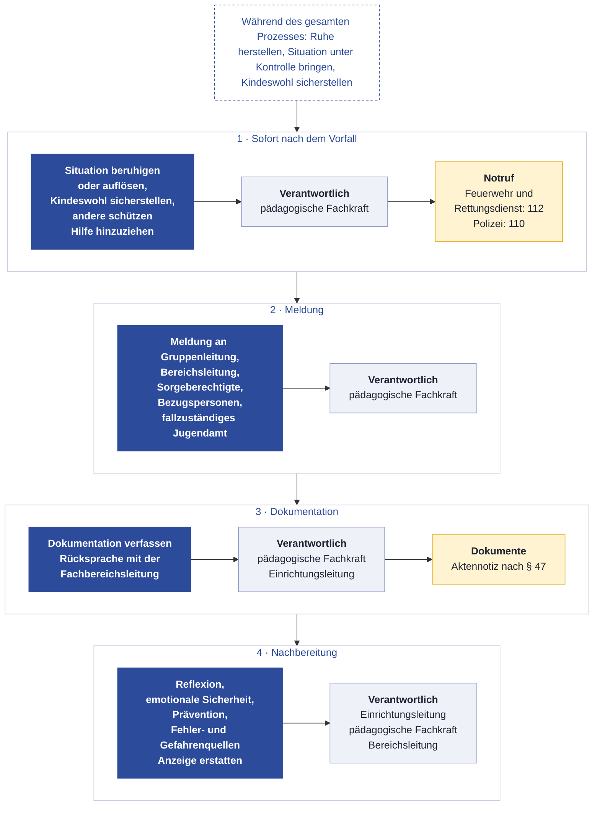

# 9.8 Ablauf Gefährdungsmomente und Übergriffe

Kapitel: 9 Hilfeprozesse · Kennung: 9.8 · Revision: 0004 (Entwurf) · Stand: 19.11.2026

Zugeordnete Prozesse: OFFEN

OFFEN: Die Prozesslandkarte führt keinen namensgleichen Prozess. Welchem Prozess das Dokument zugeordnet wird, legt der Träger fest.

OFFEN: Stellen für „erstellt“, „geprüft“ und „freigegeben“, Verteiler und Zeitpunkt der nächsten Überprüfung sind nicht benannt.

## 1 Zweck und Zuständigkeit

| | |
|---|---|
| Zweck | Institutioneller Handlungsplan bei gewalttätigen Übergriffen in stationären Einrichtungen |
| verantwortlich | Geschäftsführung, Bereichsleitung, Einrichtungsleitung, pädagogische Fachkräfte |
| rechtliche Grundlagen | § 45 SGB VIII, § 47 Satz 1 Nr. 2 SGB VIII |

## 2 Beschreibung

| Nr. | Beschreibung | verantwortlich | Dokumente/Formulare |
|---|---|---|---|
| 1 | Verhalten nach dem Vorfall: Situation beruhigen oder auflösen, Kindeswohl sicherstellen, andere schützen. | pädagogische Fachkraft | |
| 2 | Hilfe hinzuziehen: Polizei, Rettungsdienst, weitere Kolleginnen und Kollegen. | | Feuerwehr und Rettungsdienst: 112; Polizei: 110 |
| 3 | Während des gesamten Prozesses: Ruhe herstellen, Situation unter Kontrolle bringen, Kindeswohl sicherstellen. | | |
| 4 | Meldung an:; – Gruppenleitung; – Bereichsleitung; – Sorgeberechtigte der übergriffigen und der betroffenen Person; – nicht sorgeberechtigte Eltern, Angehörige oder primäre Bezugspersonen der übergriffigen und der betroffenen Person; – fallzuständiges Jugendamt der übergriffigen und der betroffenen Person | pädagogische Fachkraft | Aktennotiz nach § 47 |
| 5 | Dokumentation verfassen. | pädagogische Fachkraft; Einrichtungsleitung | |
| 6 | Nach Rücksprache mit der Fachbereichsleitung Aktennotiz nach § 47 verfassen. | | |
| 7 | Reflexion, emotionale Sicherheit herstellen, Prävention überlegen, Fehler- und Gefahrenquellen herausfiltern. | | |
| 8 | Anzeige erstatten:; – durch die betroffene Person selbst; – durch die Sorgeberechtigten; – durch Einrichtungsleitung oder pädagogische Fachkräfte der Wohngruppe | Einrichtungsleitung; pädagogische Fachkraft; Bereichsleitung | |

OFFEN: Schritt 2 – die Vorlage sagt „bei Bedarf“. In welchen Fällen Polizei und Rettungsdienst hinzugezogen werden, ist nicht festgelegt.

OFFEN: Schritt 4 – die Vorlage sagt „je nach Fall“. In welchen Fällen nicht sorgeberechtigte Eltern, Angehörige oder Bezugspersonen informiert werden, ist nicht festgelegt. Fristen für die Meldungen fehlen.

OFFEN: Schritt 8 – die Vorlage sagt „Ggf“. In welchen Fällen Anzeige erstattet wird und wer darüber entscheidet, ist nicht festgelegt.

OFFEN: Die Vorlage ordnet die Angaben der Spalten „verantwortlich“ und „Dokumente/Formulare“ nicht jedem Schritt zu; sie stehen hier nach ihrer Lage in der Vorlage.

## 3 Ablauf

Lesart: je Zeile ein Abschnitt des Ablaufs; links der Prozessschritt (blau), in der Mitte die Verantwortung (hellblau), rechts Notruf oder Dokumente (gelb). Die Vorlage enthält kein Flussdiagramm; die Darstellung ist aus der Beschreibung abgeleitet.

## 4 Risikobetrachtung

OFFEN: Die Vorlage enthält keine Risikobetrachtung.

## Reflexion und Weiterentwicklung

Vorschlag nach dem Standard, Abschnitt 3.2; vom Träger nicht bestätigt.

Leitfragen zur Reflexion des Handelns:

1. Wie wurde die Situation beruhigt, und wodurch war das Kindeswohl gesichert?
2. Welche Hilfe wurde hinzugezogen, und kam sie an, als sie gebraucht wurde?
3. Wann gingen die Meldungen an Leitung, Sorgeberechtigte und Jugendamt, und was hat sie verzögert?
4. Wo wurde vom beschriebenen Vorgehen abgewichen, und mit welcher Begründung?
5. Wie haben die beteiligten jungen Menschen und die Fachkräfte den Vorfall und die Nachbereitung erlebt?
6. Welche Fehler- und Gefahrenquellen wurden erkannt, und was wird geändert?

OFFEN: Ort der Reflexion.

OFFEN: Weg der Rückmeldung an die für das Dokument verantwortliche Stelle.

## Änderungen

| Revision | Datum | Änderung | Grund |
|---|---|---|---|
| 0003 | 08.2026 | Stand der Vorlage (erstellt 03.07.2026 S. Brand, geprüft 21.08.2026 H. Wenkel, freigegeben B. Strien-Bartelt) | – |
| 0004 (Entwurf) | 19.11.2026 | Überführung in Markdown; Aufbau nach dem Musterdokument 9.1.4; Schritte nummeriert; Flussdiagramm aus der Beschreibung abgeleitet; Zeile „Zugeordnete Prozesse“ und Teil „Reflexion und Weiterentwicklung“ ergänzt | Standard QM-Dokumente |
| 0004 (Entwurf) | 19.11.2026 | Schreibweisen bereinigt: Abkürzungen ausgeschrieben („stat.“, „päd.“, „FBL“), Paarform statt Genderstern, „übergriffige und betroffene Person“ statt „Täter und Opfer“; unbestimmte Angaben („bei Bedarf“, „je nach Fall“, „Ggf“) entfernt und als offen gekennzeichnet | Schreibregeln des Trägers; Festlegungen des Trägers vom 19.11.2026 |

Vorlage: `alt/9.8_Ablauf_Gefaehrdungsmomente.docx`. Befunde: `befunde-gliederung.md`, Abschnitt 7.
